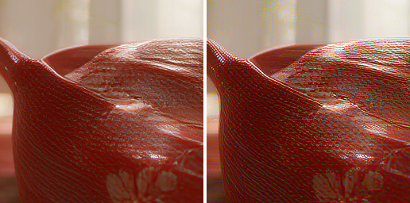
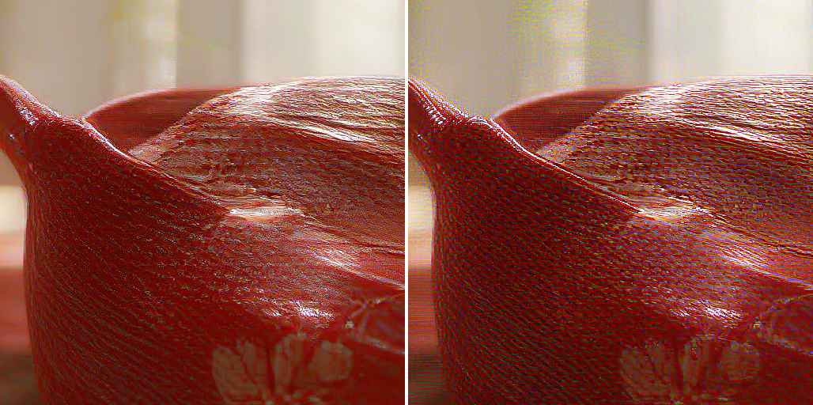
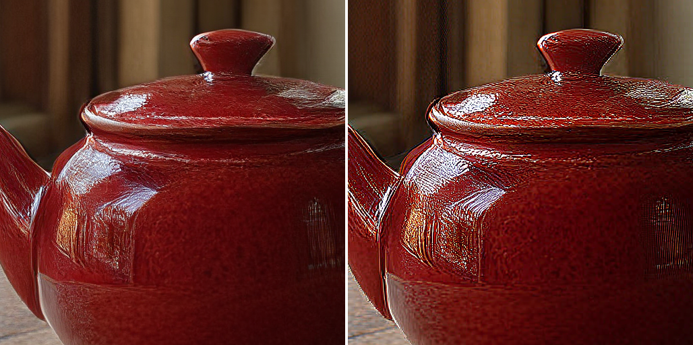

# Steppe FLUX.2 for Forge Neo

Enlarges the image after generation, just before Forge decodes it. A 512 × 768 generation becomes 1024 × 1536 at 2× or 2048 × 3072 at 4×.

## Lite and Base at 2× and 4×

Each pair uses the same prompt, seed (123), 256 × 256 generation size and fine-detail setting (0.9) on an RTX 5090. **Lite is on the left and Base is on the right.** The crops show the same central region at its original output resolution. Open the full PNGs to inspect the whole image.

### FLUX.2 Klein 4B

**2× · 512 × 512 output**

[Lite PNG](docs/comparison/klein-2x-lite.png) · [Base PNG](docs/comparison/klein-2x-base.png)

**4× · 1024 × 1024 output**

[Lite PNG](docs/comparison/klein-4x-lite.png) · [Base PNG](docs/comparison/klein-4x-base.png)

MOSS-Image comparisons

**2× · 512 × 512 output**

[Lite PNG](docs/comparison/moss-2x-lite.png) · [Base PNG](docs/comparison/moss-2x-base.png)

**4× · 1024 × 1024 output**

[Lite PNG](docs/comparison/moss-4x-lite.png) · [Base PNG](docs/comparison/moss-4x-base.png)

FLUX.3 FP8 comparisons

**2× · 512 × 512 output**

[Lite PNG](docs/comparison/flux3-2x-lite.png) · [Base PNG](docs/comparison/flux3-2x-base.png)

**4× · 1024 × 1024 output**

[Lite PNG](docs/comparison/flux3-4x-lite.png) · [Base PNG](docs/comparison/flux3-4x-base.png)

## Use

1. Place this folder under Forge's `extensions` and restart Forge.
2. Select FLUX.2 Klein or MOSS-Image with its FLUX.2 VAE.
3. In txt2img or plain img2img, open **Steppe FLUX.2 latent upscale** and turn on **Enable Steppe**.
4. Start with **2x**, **Standard (1 step)** and **Fine detail 0.9**. Leave Hires. fix off and click **Generate**. Lower Fine detail for softer textures.

The selected weights download on first use into `models/Steppe`. You can also place the official file there manually. Lite downloads about 40 MB and Base about 384 MB. Base uses 30 steps per pass. Both dimensions double each pass, so 4× produces sixteen times as many pixels as the input. [Official weights](https://huggingface.co/TensorForger/Steppe-Flux.2/tree/ed6867c62927f79fc6d1d5b3ab0aad33d1e2aa71)

## How it works

Forge's native path exposes a 128-channel compressed image. Steppe rearranges it into a finer grid, learns where to add detail, and returns a larger compressed image. The VAE turns that into the final pixels once. Standard learned from the slower Base model and runs once per 2× pass. Both use the generation seed. [Upstream implementation](https://github.com/TensorForger/ComfyUI-Steppe/tree/df0ab4ba218e5b7509a6c30ecf0db55a0b17ab83)

TensorForger tested 1,000 photos at 512 → 1024 on an RTX 5090. Standard took 172 ms including decoding and scored 1.75 on patch FID, a measure of how closely small image regions resemble real photos. Base took 1,671 ms and scored 1.72. These are the author's measurements. Tiny lettering and distant faces remain difficult. [Model card and benchmark](https://huggingface.co/TensorForger/Steppe-Flux.2/blob/ed6867c62927f79fc6d1d5b3ab0aad33d1e2aa71/README.md)

## Compatibility

The native hook checks the actual FLUX.2 VAE and packed image format. Masked img2img is skipped to preserve the original mask alignment. Wan, Qwen-Image, SDXL and FLUX.1 use different formats. Ideogram's custom pipeline uses different channel ordering. The optional adapter targets the Project Invisible FLUX.3 extension, whose decoder takes a sequence of image positions and values. It reconstructs the grid before Steppe runs and builds new positions for the larger image. [Original announcement](https://www.reddit.com/r/StableDiffusion/comments/1y5ct0b/steppeflux2_generative_latent_upscaler_for/)

The bundled inference package comes from TensorForger's MIT-licensed Steppe 1.1.0. See LICENSE and NOTICE. Uses the PyTorch environment included with Forge.

## Local tests

On an RTX 5090, Forge's Generate API returned 512 × 512 images for 256 × 256 requests with FLUX.2 Klein 4B, MOSS-Image and the original Project Invisible FLUX.3 FP8 runtime. MOSS also passed unmasked img2img. The saved FLUX.3 PNG matched the returned image and recorded the enlarged dimensions. Separate tests decoded a 256 × 256 input at 512 × 512 and 1024 × 1024 with both the Forge FLUX.2 VAE and the FLUX.3 decoder.

The tests above used Standard. Lite and Base also passed twelve Forge txt2img tests on the RTX 5090. Each model ran at 2× and 4× with Klein 4B, MOSS-Image and FLUX.3 FP8. From a 256 × 256 request, every saved PNG had the expected 512 × 512 or 1024 × 1024 dimensions, matched the returned pixels, and recorded the selected Steppe model and scale. The tests used one prompt and seed. Other GPUs, output sizes and FLUX.3 profiles remain unverified.
